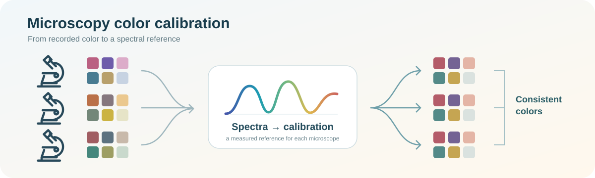

<p align="center"></p>

# Microscopy color calibration

[Полное руководство на русском](README.ru.md)

**Official research release** accompanying [*Color Calibration Slide for Digital Microscopy Systems*](https://doi.org/10.1007/s11018-022-02014-7) and [*Development of metrological support for color calibration of digital microscopy systems*](https://doi.org/10.1088/1742-6596/2192/1/012010).

The same slide can look different on different microscopes: the illumination, optics, sensor response and camera processing all affect its recorded colors. A calibration slide connects those recorded colors to spectral measurements. This makes color differences measurable and helps separate changes in the specimen from changes in the imaging system.

This repository follows the original data from spectral exports and microscope images to color coordinates, slide/dye gamut comparisons, and polynomial color correction. **Each microscope is calibrated against spectral references measured on that same microscope.** The fitting variables are CIE Lab coordinates derived from recorded RGB; this is not an image-to-image fit between microscopes.

The research was originally carried out with MATLAB, with a separate Python implementation of the polynomial experiments. The original files are preserved in `original-research-code.zip`, with a file guide inside. The present Python rewrite provides a simpler, documented route through the research. Historical and corrected results are kept in separate folders.

## Start here

1. Download this repository and the accompanying [data and release files](https://disk.yandex.ru/d/D495fZYlgSzGCA).
2. Extract `spectra-and-references.zip` and `microscope-images.zip` into the same parent directory. Both contain the common folder `color-calibration-data`. Extract `misc.zip` there too if you want acquisition records, saved intermediates and original notes. See the [data guide](docs/en/data.md).
3. Create the Python environment below.
4. Copy `config.example.json` to `config.json` and change `data_root` to your extracted data folder. Relative paths are resolved from the configuration file; forward slashes work on Windows.
5. Open one of the four notebooks in JupyterLab and use **Restart Kernel and Run All Cells**. The notebooks call the preprocessing functions themselves; you do not need to run them twice.

```json
{
  "data_root": "F:/repos/color-calibration-data",
  "artifacts_root": "artifacts"
}
```

Outputs go to `artifacts/`; source files remain unchanged. A precomputed `artifacts.zip` is also supplied, including executed notebooks and standalone interactive HTML figures. Extract its `artifacts` folder beside this README, or point `artifacts_root` elsewhere. GitHub does not execute notebook JavaScript; open the notebook locally or open the exported HTML file.

## Python environment

Use **Python 3.12**, the version used for the supplied results. From this repository folder:

```powershell
python -m venv .venv
.venv\Scripts\Activate.ps1
python -m pip install -r requirements.txt
python -m jupyter lab
```

On Linux/macOS, activate with `source .venv/bin/activate`. In JupyterLab select the Python environment you just created. No package installation in editable mode, command-line application or test suite is required. The repository contains reusable Python functions and ordinary scripts.

## Choose a walkthrough

| Workflow | English | Русский |
|---|---|---|
| Historical reproduction | [Open notebook](notebooks/historical_en.ipynb) | [Открыть блокнот](notebooks/historical_ru.ipynb) |
| Explicitly corrected workflow | [Open notebook](notebooks/corrected_en.ipynb) | [Открыть блокнот](notebooks/corrected_ru.ipynb) |

Each notebook prepares camera sensitivities, observer functions, dyes and reference targets; processes both microscopes' spectra and images; draws the gamut figure; compares polynomial degrees 1–5; applies the fitted correction to a recorded color-field image; and ends with an interactive chromaticity diagram. Whole datasets have separate point and hull switches. The CCD triangle is the default reference, and the coverage table updates when another reference is selected.

## Hardware and acquisition

The laboratory record `Режимы съемки.docx` is the source of the following setup. Model labels are retained as recorded, including the adapter designation.

| Component | Meiji system | Olympus system |
|---|---|---|
| Microscope | Meiji MT4300 | Olympus BX41 |
| Objective | Meiji U Plan 20×/0.40 PH2, ∞/0.17, F=200, WD 7.29 | Same recorded objective |
| Camera adapter | Motic 20× (recorded label) | Motic 20× (recorded label) |
| Camera | PixeLink PLB873; Sony ICX274 | Same camera, serial 87300040 |
| Spectrometer | Solar LS S100-2048H; Hamamatsu S11639 | Same recorded spectrometer |
| Image settings | White balance on illuminator; maximum source and apertures; eye + camera path | Same recorded image settings |
| Spectral settings | Maximum source and apertures | Maximum source and collector; minimum condenser aperture |
| Spectral acquisition | 100 ms; 10 signal and 10 background frames in the note | Same |

Both screenshots show 1600×1200, gain 0 dB, saturation 100%, brightness 0 and disabled gamma control. Saved Meiji images are BMP; Olympus images are JPEG. Camera exposure and white-balance gains differ. The [hardware page](docs/en/hardware.md) contains the full parameter table and the two screenshots. The exported spectral files already represent the saved instrument output; ten individual signal/background files are not present for each field.

## What is in this repository?

| Folder | Purpose |
|---|---|
| `preprocessing/` | Seven standalone preprocessing scripts, plus shared configuration/checks |
| `analysis/` | Color conversion, spectral integration, geometry, fitting and notebook presentation helpers |
| `notebooks/` | Exactly four walkthroughs: two languages × two profiles |
| `docs/en/`, `docs/ru/` | Sources, native data formats, processing steps and limitations |
| `assets/` | Logo and acquisition screenshots |
| `artifacts/` | Generated outputs; excluded from Git |

The [preprocessing guide](docs/en/preprocessing.md) lists each input, script and output. Each script can be opened and run independently in your Python editor, or imported and called through its `main()` function. There is no separate CLI interface. Large measurements and miscellaneous research material stay in the external data bundle.

## Known issues and reproduction limits

* **Gamut coverage:** the available inputs reproduce **99.6716%** dye-hull coverage, while the papers report **99.4%**. The exact older input snapshot has not been located. We preserve this discrepancy rather than changing inputs to force agreement.
* **Historical error metric:** the archived code reports the sum of three column-wise error norms divided by the number of fields. It is different from the mean per-field ΔE76 printed in the paper. Fitting the archived Lab tables reproduces **0.7518 (Meiji, degree 3)** and **0.6587 (Olympus, degree 4)**; their actual mean ΔE76 values are approximately **3.4710** and **2.8604**.
* **Historical conventions:** the fitting tables include 98 rows (97 fields plus the illuminator), float RGB is used on a 0–255 scale, and spectral references pass through quantized/clipped RGB. The gamut calculation also normalizes each glass OD spectrum by its maximum and can produce complex intermediate values. These choices remain visible in the historical profile.
* **Numerical sensitivity:** high-degree historical polynomials are ill-conditioned. Some degree-4/5 values depend on rounding and solver details. Recomputed Olympus image means also differ slightly from the archived Lab table; the maximum Lab-coordinate difference is about 0.336 on its unusually large historical scale. No bit-for-bit claim is made for the entire old workflow.
* **Corrected is a documented alternative:** it fixes explicit scale, reference, validity and fitting issues, and reports standard mean ΔE76 and held-out errors. The present corrected glass hull covers 100% of the dye hull, but this does not establish superior calibration accuracy. The saved camera RGB encoding, wavelength-response calibration, acquisition differences and incomplete provenance still limit interpretation.

See [historical versus corrected](docs/en/corrections.md) for every implemented change and the checks that remain outside the available evidence. Objective-transmission downloads are omitted because they were not used in the reproduced path.

## Attribution and licensing

New repository code is released under the [MIT license](LICENSE). Dye spectra were supplied by **Daria Dobrolyubova**, Denis Makhov's former colleague and fellow PhD student at Bauman Moscow State Technical University; the instrument and measurement protocol are not documented. Published figures, manufacturer data, third-party functions in the original archive and external datasets retain their respective rights; MIT does not relicense them. The data documentation records those sources and unresolved provenance.

## Preferred citations

Please cite both papers when using this research, and state the data release, notebook profile, observer and error definition used. Machine-readable references are in [CITATION.cff](CITATION.cff).

1. D. S. Makhov, G. R. Sagatelyan, A. V. Samorodov. **Color Calibration Slide for Digital Microscopy Systems.** *Measurement Techniques* (2022). [DOI: 10.1007/s11018-022-02014-7](https://doi.org/10.1007/s11018-022-02014-7). Russian original: [10.32446/0368-1025it.2021-10-60-64](https://doi.org/10.32446/0368-1025it.2021-10-60-64).
2. D. S. Makhov, O. A. Samorodova, N. P. Muravskaya, A. V. Samorodov. **Development of metrological support for color calibration of digital microscopy systems.** *Journal of Physics: Conference Series* **2192**, 012010 (2022). [DOI: 10.1088/1742-6596/2192/1/012010](https://doi.org/10.1088/1742-6596/2192/1/012010).
