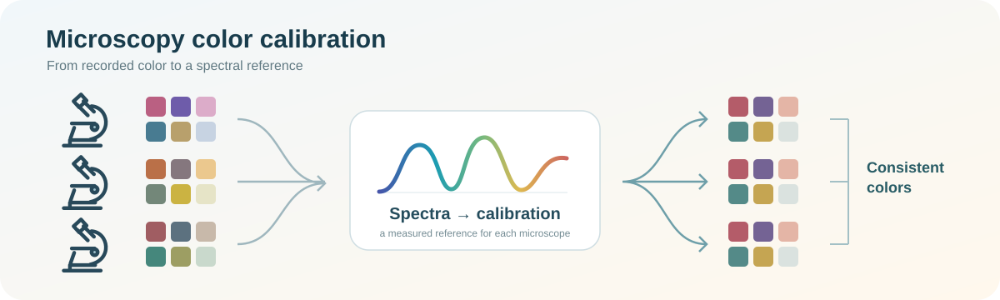

<p align="center"></p>

# Цветовая калибровка цифровых микроскопов

[Full English guide](README.md)

**Официальная публикация материалов исследования** к статьям [*Color Calibration Slide for Digital Microscopy Systems*](https://doi.org/10.1007/s11018-022-02014-7) и [*Development of metrological support for color calibration of digital microscopy systems*](https://doi.org/10.1088/1742-6596/2192/1/012010).

Один препарат может выглядеть по-разному на разных микроскопах. На зарегистрированный цвет влияют источник света, оптика, чувствительность сенсора и обработка в камере. Цветовая мера связывает цвета изображения со спектральными измерениями. Благодаря этому можно количественно оценивать цветовые различия и отделять изменение объекта от изменения измерительной системы.

Здесь показан весь путь: спектральные экспорты и изображения → цветовые координаты → сравнение охватов мер и красителей → полиномиальная коррекция. **Каждый микроскоп калибруется относительно спектральных измерений на том же микроскопе.** Полиномы работают с координатами CIE Lab, рассчитанными из зарегистрированных RGB. Это не обучение преобразованию между изображениями двух микроскопов.

Изначально исследование выполнялось в MATLAB; полиномиальные эксперименты дополнительно были реализованы на Python. Исходные файлы сохранены в `original-research-code.zip` с отдельным описанием назначения файлов. Текущая версия на Python упрощает прохождение исследования. Исторический и исправленный варианты сохраняют результаты в разные каталоги.

## С чего начать

1. Скачайте репозиторий и [данные с сопроводительными файлами](https://disk.yandex.ru/d/D495fZYlgSzGCA).
2. Распакуйте `spectra-and-references.zip` и `microscope-images.zip` в один родительский каталог. Оба архива содержат общую папку `color-calibration-data`. Туда же можно распаковать `misc.zip` с режимами съемки, сохраненными промежуточными результатами и исходными записями. Подробнее — в [описании данных](docs/ru/data.md).
3. Создайте окружение Python по инструкции ниже.
4. Скопируйте `config.example.json` в `config.json`; в `data_root` укажите каталог распакованных данных. Относительные пути отсчитываются от файла конфигурации; в Windows можно использовать прямые косые черты.
5. Откройте один из четырех блокнотов в JupyterLab и выполните **Restart Kernel and Run All Cells**. Блокнот сам вызывает функции предобработки, поэтому отдельно повторять эти действия не нужно.

```json
{
  "data_root": "F:/repos/color-calibration-data",
  "artifacts_root": "artifacts"
}
```

Результаты записываются в `artifacts/`, исходные данные не изменяются. Архив `artifacts.zip` содержит готовые результаты, выполненные блокноты и автономные интерактивные HTML-диаграммы. Его папку `artifacts` можно разместить рядом с этим README либо изменить `artifacts_root`. GitHub не выполняет JavaScript в блокнотах: для интерактивной диаграммы откройте блокнот локально или отдельный HTML-файл.

## Окружение Python

Рекомендуется **Python 3.12**, использованный для приложенных результатов. Выполните из каталога репозитория:

```powershell
python -m venv .venv
.venv\Scripts\Activate.ps1
python -m pip install -r requirements.txt
python -m jupyter lab
```

В Linux/macOS активация: `source .venv/bin/activate`. В JupyterLab выберите созданное окружение Python. Установка пакета в редактируемом режиме, отдельное консольное приложение и набор тестов не нужны: используются обычные скрипты и повторно используемые функции.

## Какой блокнот выбрать

| Вариант | Русский | English |
|---|---|---|
| Историческое воспроизведение | [Открыть блокнот](notebooks/historical_ru.ipynb) | [Open notebook](notebooks/historical_en.ipynb) |
| Явно исправленный расчет | [Открыть блокнот](notebooks/corrected_ru.ipynb) | [Open notebook](notebooks/corrected_en.ipynb) |

Каждый блокнот готовит чувствительности камеры, функции стандартного наблюдателя, красители и другие меры; обрабатывает спектры и изображения обоих микроскопов; строит диаграмму охватов; сравнивает степени полиномов 1–5; применяет коррекцию к изображению цветового поля и заканчивается интерактивной диаграммой цветности. Точки и оболочки переключаются для набора целиком. По умолчанию эталоном служит треугольник CCD; при смене эталона таблица покрытия пересчитывается.

## Оборудование и режимы съемки

Источник таблицы — лабораторная запись `Режимы съемки.docx`. Обозначения сохранены так, как записаны, включая адаптер.

| Компонент | Система Meiji | Система Olympus |
|---|---|---|
| Микроскоп | Meiji MT4300 | Olympus BX41 |
| Объектив | Meiji U Plan 20×/0.40 PH2, ∞/0.17, F=200, WD 7.29 | Тот же по записи |
| Адаптер камеры | Motic 20× (обозначение из записи) | Motic 20× (обозначение из записи) |
| Камера | PixeLink PLB873; Sony ICX274 | Та же камера, серийный № 87300040 |
| Спектрометр | Solar LS S100-2048H; Hamamatsu S11639 | Тот же по записи |
| Изображения | Баланс белого по осветителю; максимум источника и диафрагм; путь глаз + камера | Те же режимы по записи |
| Спектры | Максимум источника и диафрагм | Максимум источника и коллектора; минимум диафрагмы конденсора |
| Спектральная регистрация | 100 мс; 10 кадров сигнала и 10 фона по записи | То же |

На обоих скриншотах: 1600×1200, усиление 0 дБ, насыщенность 100%, яркость 0; управление гаммой отключено. Сохраненные изображения Meiji имеют формат BMP, Olympus — JPEG. Экспозиция камеры и коэффициенты баланса белого различаются. Полная таблица и скриншоты находятся на [странице оборудования](docs/ru/hardware.md). Спектральные CSV уже являются сохраненным экспортом прибора; десять отдельных файлов сигнала и фона для каждого поля отсутствуют.

## Состав репозитория

| Каталог | Назначение |
|---|---|
| `preprocessing/` | Семь самостоятельных скриптов предобработки и общие функции конфигурации/проверки |
| `analysis/` | Цветовые преобразования, интегрирование, геометрия, полиномы и функции оформления блокнотов |
| `notebooks/` | Ровно четыре блокнота: два языка × два варианта расчета |
| `docs/en/`, `docs/ru/` | Источники, форматы, обработка и ограничения |
| `assets/` | Логотип и скриншоты режимов камеры |
| `artifacts/` | Результаты; не включаются в Git |

В [руководстве по предобработке](docs/ru/preprocessing.md) каждому входу сопоставлены скрипт и результат. Скрипт можно открыть и выполнить отдельно в редакторе Python или импортировать его функцию `main()`. Отдельного интерфейса командной строки нет. Большие измерения и дополнительные материалы находятся во внешнем наборе данных.

## Известные проблемы и пределы воспроизведения

* **Покрытие охвата:** доступные данные дают **99.6716%** покрытия оболочки красителей, в статьях указано **99.4%**. Точный прежний набор входов не найден. Расхождение сохранено, входы для подгонки результата не меняются.
* **Исторический показатель ошибки:** исходный код складывает три нормы столбцов ошибок и делит на число полей. Это отличается от среднего ΔE76 по полям, определенного в формуле статьи. По архивным Lab-таблицам получаются **0.7518 (Meiji, степень 3)** и **0.6587 (Olympus, степень 4)**; действительные средние ΔE76 составляют примерно **3.4710** и **2.8604**.
* **Исторические соглашения:** в обучении 98 строк (97 полей и осветитель), вещественные RGB подаются в масштабе 0–255, спектральные эталоны проходят через квантованные и ограниченные RGB. Для охвата OD каждого стекла нормируется на собственный максимум, возможны комплексные промежуточные значения. Все эти особенности явно сохранены в историческом варианте.
* **Численная чувствительность:** полиномы высоких степеней плохо обусловлены; отдельные значения для степеней 4–5 зависят от округления и решателя. Пересчитанные средние цветов Olympus немного отличаются от архивной Lab-таблицы: максимум расхождения координаты около 0.336 при необычно крупном историческом масштабе. Полная побитовая идентичность не заявляется.
* **Исправленный вариант — документированная альтернатива:** исправлены явно обнаруженные проблемы масштаба, эталонов, допустимости значений и обучения; добавлены среднее ΔE76 и ошибки на отложенных полях. Исправленная оболочка стекол покрывает 100% оболочки красителей, что само по себе не доказывает лучшую точность калибровки. Кодирование RGB камеры, спектральная калибровка прибора, различия режимов съемки и неполные сведения о происхождении остаются ограничениями.

Все изменения перечислены на странице [сравнения вариантов](docs/ru/corrections.md). Загруженные ранее кривые пропускания объективов не включены: в воспроизводимом пути они не использовались.

## Благодарности и лицензирование

Новый код распространяется по [лицензии MIT](LICENSE). Спектры красителей предоставила **Дарья Добролюбова (Daria Dobrolyubova)**, бывшая коллега Дениса Махова и аспирантка МГТУ им. Н. Э. Баумана. Прибор и протокол измерений не документированы. Опубликованные рисунки, данные производителей, сторонние функции в исходном архиве и внешние наборы сохраняют собственные права; лицензия MIT на них не распространяется. Источники и пробелы в происхождении указаны в документации.

## Рекомендуемое цитирование

При использовании исследования цитируйте обе статьи и указывайте версию данных, вариант блокнота, наблюдателя и определение ошибки. Машиночитаемые сведения находятся в [CITATION.cff](CITATION.cff).

1. D. S. Makhov, G. R. Sagatelyan, A. V. Samorodov. **Color Calibration Slide for Digital Microscopy Systems.** *Measurement Techniques* (2022). [DOI: 10.1007/s11018-022-02014-7](https://doi.org/10.1007/s11018-022-02014-7). Russian original: [10.32446/0368-1025it.2021-10-60-64](https://doi.org/10.32446/0368-1025it.2021-10-60-64).
2. D. S. Makhov, O. A. Samorodova, N. P. Muravskaya, A. V. Samorodov. **Development of metrological support for color calibration of digital microscopy systems.** *Journal of Physics: Conference Series* **2192**, 012010 (2022). [DOI: 10.1088/1742-6596/2192/1/012010](https://doi.org/10.1088/1742-6596/2192/1/012010).
