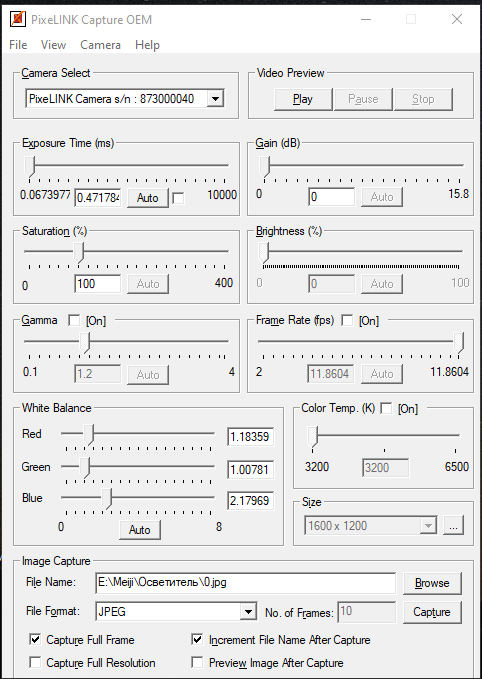
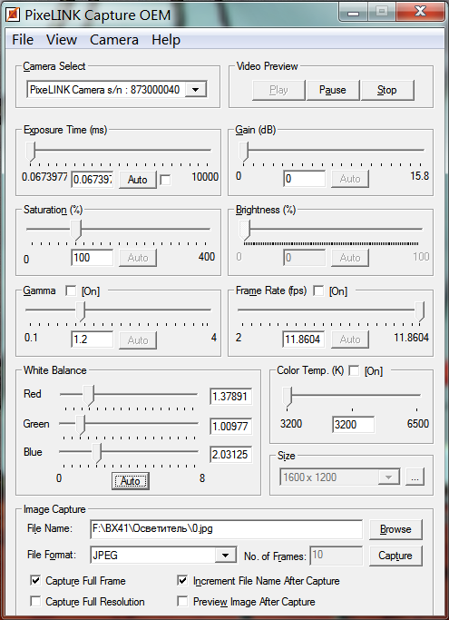

# Hardware and acquisition evidence

[README](../../README.md) · [Русский](../ru/hardware.md)

The primary records are `misc/acquisition/Режимы съемки.docx`, `misc/acquisition/<system>/Параметры.PNG` and the associated `.labws` instrument projects. The README summarizes the recorded optical setup. The objective and Motic adapter labels are transcribed from the note; an independently verified adapter magnification is unavailable.

| Parameter | Meiji screenshot | Olympus screenshot |
|---|---|---|
| Camera | PixeLink PLB873, serial 87300040 | Same |
| Frame size | 1600×1200 | 1600×1200 |
| Gain / brightness / saturation | 0 dB / 0 / 100% | 0 dB / 0 / 100% |
| Illuminator-image exposure | Approximately 0.47178 ms | Approximately 0.06739 ms |
| White-balance R / G / B | 1.18359 / 1.00781 / 2.17969 | 1.37891 / 1.00977 / 2.03125 |
| Gamma | Unchecked; grayed value 1.2 | Unchecked; grayed value 1.2 |
| Frame-rate control | Unchecked; displayed 11.8604 fps | Unchecked; displayed 11.8604 fps |
| Color-temperature control | Unchecked; displayed 3200 K | Unchecked; displayed 3200 K |
| Auto exposure | Unchecked | Unchecked |
| Capture panel | JPEG, 10 frames, increment filename | JPEG, 10 frames, increment filename |
| Surviving research files | BMP | JPEG |

Values in disabled controls are not active settings. The screenshots show an illuminator capture, not a complete exposure log for every field. The file-format discrepancy in Meiji is left explicit. The note states white balance on the illuminator, maximum image apertures and maximum source brightness. For Olympus spectral acquisition it instead records a minimum condenser aperture. These acquisition conditions cannot be repaired retrospectively by a numerical correction.

The note specifies ten signal and ten background frames at 100 ms and explicitly asks to check the instrument projects. The available exports do not expose ten separate raw/background CSV files per field. No unsupported dark-subtraction history is invented.

## Meiji camera screenshot

## Olympus camera screenshot

