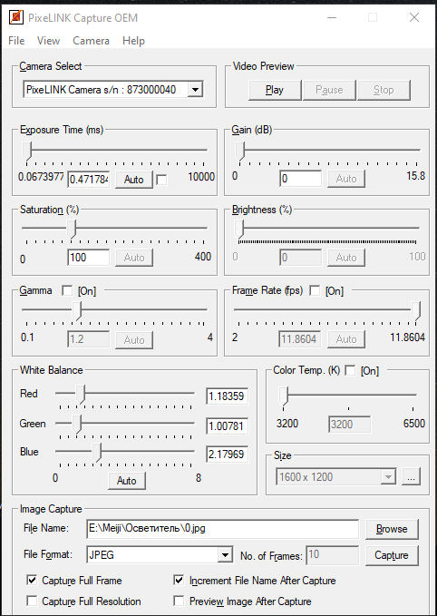
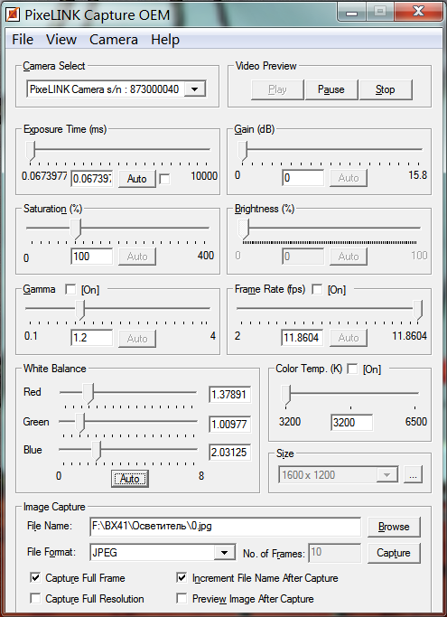

# Оборудование и подтверждающие записи

[README](../../README.ru.md) · [English](../en/hardware.md)

Первичные записи: `misc/acquisition/Режимы съемки.docx`, `misc/acquisition/<микроскоп>/Параметры.PNG` и проекты прибора `.labws`. В README приведена оптическая схема по этой записи. Обозначения объектива и адаптера Motic перенесены без изменения; независимого подтверждения увеличения адаптера нет.

| Параметр | Скриншот Meiji | Скриншот Olympus |
|---|---|---|
| Камера | PixeLink PLB873, серийный № 87300040 | Та же |
| Размер кадра | 1600×1200 | 1600×1200 |
| Усиление / яркость / насыщенность | 0 дБ / 0 / 100% | 0 дБ / 0 / 100% |
| Выдержка изображения осветителя | Примерно 0.47178 мс | Примерно 0.06739 мс |
| Баланс белого R / G / B | 1.18359 / 1.00781 / 2.17969 | 1.37891 / 1.00977 / 2.03125 |
| Гамма | Галочка снята; неактивное значение 1.2 | То же |
| Управление частотой кадров | Выключено; показано 11.8604 кадр/с | То же |
| Управление цветовой температурой | Выключено; показано 3200 K | То же |
| Автоэкспозиция | Галочка снята | Галочка снята |
| Панель сохранения | JPEG, 10 кадров, увеличение номера файла | То же |
| Сохранившиеся файлы | BMP | JPEG |

Значения неактивных контролов не являются включенными настройками. Скриншоты показывают съемку осветителя, а не журнал экспозиции каждого поля. Несоответствие формата Meiji указано явно. По записи баланс белого выполнялся по осветителю; при получении изображений диафрагмы и яркость источника максимальны. Для спектров Olympus отдельно указан минимум диафрагмы конденсора. Эти различия съемки нельзя ретроспективно исправить только расчетом.

В записи указаны десять кадров сигнала и десять фона при 100 мс, а также просьба проверить проекты прибора. Десять отдельных исходных/фоновых CSV на поле не сохранились в доступных экспортах. Неподтвержденная история вычитания фона не достраивается.

## Параметры камеры Meiji

## Параметры камеры Olympus

